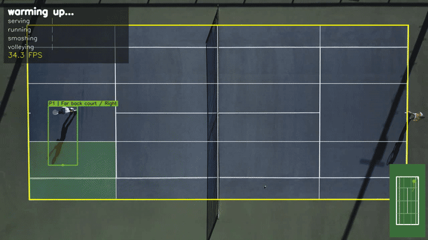
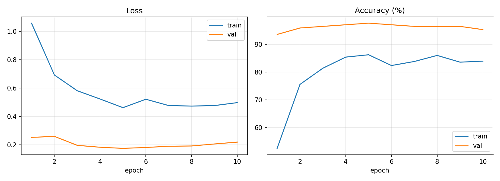
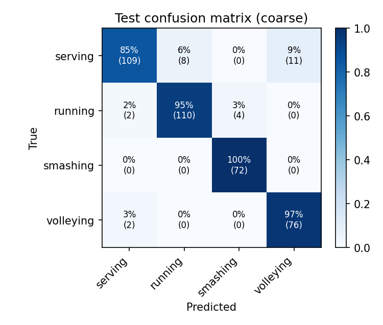

# Sports Video Player Action Recognition & Court Zone Tracking

A computer vision system for sports analytics that:

1. **Recognises player actions** — *serving, running, smashing, volleying* — from video clips using a
   **2D CNN feature extractor + LSTM temporal model** (PyTorch).
2. **Tracks players and maps them to court zones** — person detection → SORT-style Kalman tracking →
   homography to court coordinates → time-in-zone, zone transitions, distance covered, speed, heatmap.
3. **Measures accuracy and frame rate** — accuracy, macro-F1, per-class report, confusion matrix,
   model-only throughput, and end-to-end streaming FPS.

Everything runs for free on Google Colab (T4 GPU) with the UCF101 dataset from Kaggle.

[](https://colab.research.google.com/github/LuShadowX/sports-action-recognition/blob/main/notebooks/Sports_Action_Recognition_Colab.ipynb)

### Demo



*Aerial tennis clip: live action label + class probabilities and FPS (top-left), tracked players with their court zone, and a top-down court minimap (bottom-right). Full-quality demo videos and the trained model are in the [latest release](https://github.com/LuShadowX/sports-action-recognition/releases/latest).*

**Final result (ResNet-50 + BiLSTM, UCF101 split 1, 394 unseen test videos): 93.2% accuracy, macro-F1 0.935, 25-32 FPS end-to-end with tracking on a free Colab T4.**

---

## Architecture

```
video clip ──► uniform/segment sampling (16 frames, 160×160)
                 │
                 ▼
     ResNet-50 (ImageNet, shared across frames)  ── per-frame 2048-d features  [B,T,2048]
                 │
                 ▼
     2-layer Bi-LSTM (256 per direction)          ── temporal dynamics          [B,T,512]
                 │
                 ▼
     temporal attention pooling                   ── weights the key frames     [B,512]
                 │
                 ▼
     LayerNorm → Dropout → Linear                 ── action logits             [B,4]
```

```
match video ──► StreamingActionRecognizer (CNN on every k-th frame, LSTM over the last 16 features, EMA smoothing)
            ├─► Faster R-CNN MobileNetV3 person detector ──► SORT tracker (Kalman + Hungarian IoU)
            │                                                     │ foot point (bottom-centre of box)
            │                                                     ▼
            └─────────────────────────────────────────► homography → court metres → zone, distance, speed
                                                                  ▼
                                annotated MP4 + minimap + summary JSON + tracks CSV + heatmap
```

**Design choices**

| Choice | Why |
|---|---|
| Group-based splits (official UCF101 split 1; val carved from *training groups*) | Clips in a group share actors/scene; random splits leak and inflate accuracy. |
| TSN-style segment sampling from 32 cached frames | Covers the whole action, adds temporal augmentation for free. |
| Fine-tune only the last CNN stage, frozen BatchNorm elsewhere | Small dataset → less overfitting, faster on a T4. |
| Bi-LSTM + attention pooling | Uses context from both directions and focuses on the decisive frames (e.g. the ball strike). |
| Normalisation on GPU, uint8 data pipeline | Keeps Colab's 2 CPU cores from bottlenecking training. |
| Streaming inference re-uses cached CNN features | Per-frame cost ≈ 1/stride of a CNN pass → real-time on a T4. |

## Dataset and label mapping

UCF101 (13,320 clips, 101 classes). UCF101 has no clips literally labelled "serving" or "volleying", so each
assignment action is represented by UCF101 sports classes with the same dominant motion
(`sportsar/data/classes.py`):

| Action | UCF101 classes |
|---|---|
| serving | TennisSwing, CricketBowling, BaseballPitch |
| running | LongJump, PoleVault, HighJump (sprint run-up) |
| smashing | VolleyballSpiking, BasketballDunk |
| volleying | TableTennisShot, SoccerJuggling |

Set `data.label_mode=fine` to train on the 10 original classes instead. Class imbalance is handled with a
class-weighted loss.

## Quick start (Colab)

Open `notebooks/Sports_Action_Recognition_Colab.ipynb` in Colab, select a **T4 GPU**, set `REPO_URL`, and run
all cells. The notebook downloads the data, trains, evaluates, benchmarks FPS and renders an annotated demo video.

## Command line

```bash
pip install -r requirements.txt

# 1. data: download from Kaggle (or --data-root /path/to/UCF-101), index, split, cache frames
python prepare_data.py --download

# 2. train (+ automatic test evaluation of the best checkpoint)
python train.py
python train.py --set model.backbone=mobilenet_v3_large --set train.output_dir=runs/mnv3

# 3. evaluate with 4-view test-time augmentation
python evaluate.py --checkpoint runs/cnn_lstm/best.pt --tta

# 4. frame-rate benchmark
python benchmark_fps.py --checkpoint runs/cnn_lstm/best.pt --video path/to/clip.avi

# 5. full pipeline on a match video (calibrated tennis court)
python infer_video.py --checkpoint runs/cnn_lstm/best.pt --video match.mp4 \
    --court tennis --court-corners "410,180;870,180;1150,650;130,650" --court-only --max-players 4
```

Court presets: `tennis`, `badminton`, `volleyball`, `basketball`, `image` (no calibration: 3×3 grid on the frame,
units in pixels). Corners are given far-left, far-right, near-right, near-left.

## Outputs

| File | Content |
|---|---|
| `runs/<exp>/best.pt` | best checkpoint (weights + config + class names) |
| `runs/<exp>/history.json`, `training_curves.png` | loss / accuracy per epoch |
| `runs/<exp>/test_metrics.json`, `confusion_matrix.png` | accuracy, macro-F1, per-class P/R/F1, throughput |
| `runs/<exp>/eval_test_tta.json` | TTA results |
| `runs/<exp>/fps_benchmark.json` | latency p50/p95, clips/s, frames/s (FP32 & AMP), streaming FPS |
| `outputs/<video>_annotated.mp4` | action panel, player IDs, zones, minimap, live FPS |
| `outputs/<video>_annotated.summary.json` | clip prediction, action timeline, per-player zone stats, speed |
| `outputs/<video>_annotated.tracks.csv` | per-frame boxes, court coordinates, zone, action |
| `outputs/<video>_annotated.heatmap.png` | court occupancy heatmap |

## Results

All numbers are on the official UCF101 split 1 **test** set (394 videos from actors never seen in training),
measured on a free Colab **Tesla T4**. The final model was chosen by **validation** accuracy, not test accuracy.

### Model comparison

| Model | Val acc | Test acc | Model FPS (T4) |
|---|---|---|---|
| **ResNet-50 + BiLSTM (final)** | **97.7%** | **93.1%** | 1,374 |
| ResNet-50 + ResNet-18 ensemble | 97.1% | 93.1% | 1,014 |
| ResNet-18 + BiLSTM, 24 frames | 94.8% | 88.6% | 4,219 |
| ResNet-34 + BiLSTM | 94.2% | 87.1% | 2,416 |
| ResNet-18 + BiLSTM | 93.0% | 86.5% | 3,864 |

Full table: [`results/comparison.json`](results/comparison.json).

### Final model (ResNet-50 + BiLSTM)

| Metric | Value |
|---|---|
| Test accuracy | **93.2%** (92.4% with 4-view TTA) |
| Macro-F1 | **0.935** |
| Recall: serving / running / smashing / volleying | 85.2% / 94.8% / 100% / 97.4% |
| Model throughput (batch 8, AMP) | 1,346 frames/s |
| Streaming, action recognition only | 426 FPS |
| Streaming, action + detection + tracking + court zones | **25-32 FPS** (real time) |

| Training curves | Confusion matrix (test) |
|---|---|
|  |  |

### Improvements that helped

| Version | Change | Test acc |
|---|---|---|
| v1 | ResNet-18 + BiLSTM baseline | 88.3% |
| v2 | + stronger augmentation (crop, rotation, random erasing, speed jitter), mixup, weight EMA | 91.9% |
| **final** | + ResNet-50 backbone | **93.2%** |

v1 overfitted (99% train vs 94% val accuracy); the v2 regularisation removed the gap.

### Real-world clips (Mixkit, not in the training data)

| Clip | Prediction | Players tracked | FPS |
|---|---|---|---|
| Aerial tennis court (calibrated court zones) | serving | 3 | 32 |
| Outdoor court | serving | 5 | 26 |
| Player serving | serving | 8 | 25 |
| Close-up serve | volleying (wrong) | 1 | 31 |

Download the trained weights (`best_resnet50.pt`) from the [latest release](https://github.com/LuShadowX/sports-action-recognition/releases/latest)
and run the full pipeline on any clip with `infer_video.py`.

## Project structure

```
configs/default.yaml          all hyper-parameters (override with --set key=value)
prepare_data.py               download, index, group-split, frame cache
train.py                      training loop + final test evaluation
evaluate.py                   test evaluation, optional TTA
benchmark_fps.py              model and streaming frame-rate benchmark
infer_video.py                full action + tracking + court-zone pipeline
sportsar/
  data/classes.py             UCF101 -> sports-action mapping
  data/ucf101.py              video indexing, official group-based splits
  data/video_io.py            decoding and frame sampling
  data/dataset.py             cached clip dataset, augmentation
  models.py                   CNN-LSTM (resnet / mobilenet_v3 / efficientnet backbones)
  engine.py                   train / eval loops, AMP, scheduler
  metrics.py                  metrics and plots
  inference.py                clip-level and streaming inference
  tracking/detector.py        person detector
  tracking/tracker.py         SORT tracker
  tracking/court.py           court presets, homography, zones, minimap, analytics
notebooks/                    Google Colab notebook
```

## Limitations

* The four actions are proxies built from UCF101 classes; the model learns them from mixed sports, not from a
  single racket sport. Fine-tuning on a dedicated tennis/badminton dataset would improve real match footage.
* Action recognition is clip-level (whole frame), not per player.
* Court zones need four manually picked corners for metric measurements; without them zones are image-plane.

## References

* Soomro, Zamir, Shah. *UCF101: A Dataset of 101 Human Actions Classes From Videos in The Wild*, 2012.
* Donahue et al. *Long-term Recurrent Convolutional Networks for Visual Recognition and Description*, CVPR 2015.
* Wang et al. *Temporal Segment Networks*, ECCV 2016.
* Bewley et al. *Simple Online and Realtime Tracking (SORT)*, ICIP 2016.
